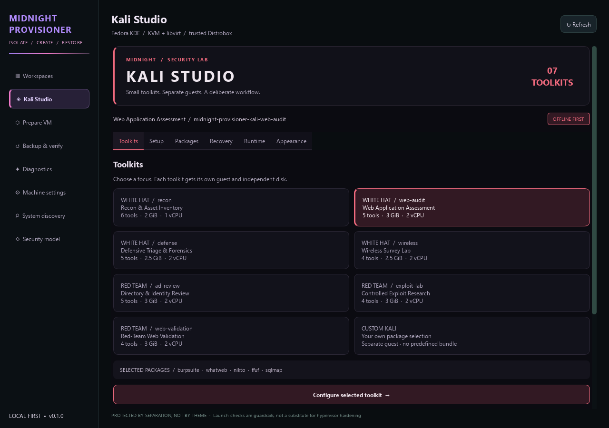
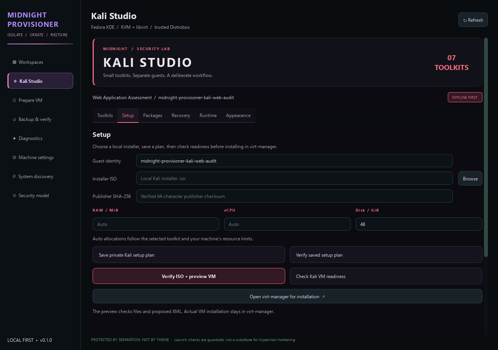
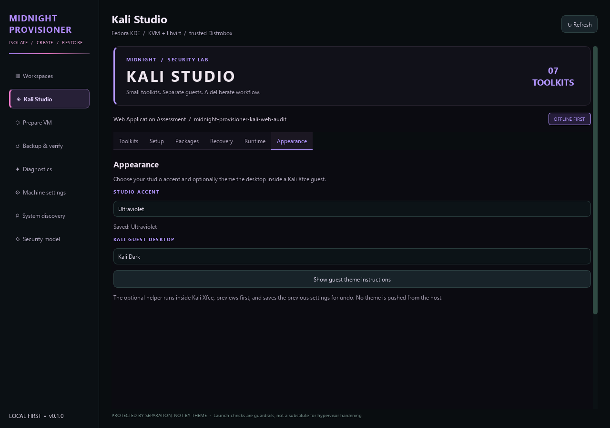
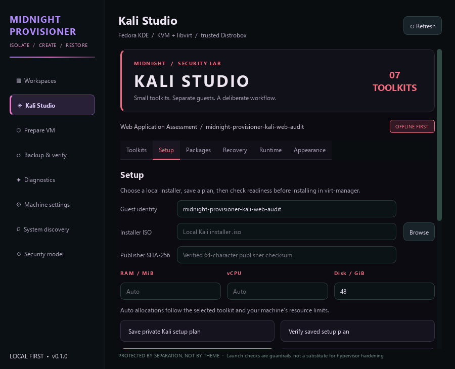

# Midnight Provisioner

**Fedora workspaces, Kali Linux toolkits, Windows 11 customization, and optional dual boot.**

Midnight Provisioner combines a Fedora KDE workspace manager, purpose-built Kali Linux VM profiles, backup and recovery tools, and Windows 11 installation and customization utilities. Use the Fedora app to organize KVM virtual machines, trusted development containers, and host diagnostics, or use the Windows tools independently. Windows/Fedora dual boot is an optional setup path.

[Fedora installation](#fedora-desktop-installation) · [Kali toolkits](#kali-linux-workspaces-and-toolkits) · [Backups and recovery](#backups-and-recovery) · [Windows only](#standalone-windows-11-installation-and-customization) · [Dual boot](#optional-windows-11-and-fedora-dual-boot) · [Tools and commands](#tools-and-commands) · [Documentation](docs/README.md) · [Security model](docs/SECURITY_MODEL.md)

## Testing status

The Midnight Provisioner GUI has not been fully tested across hardware and desktop configurations.

## Features

- **Desktop workspace controls and a companion CLI** for workspace status, VM policy inspection, diagnostics, and preparation. The GUI adds VM launch/shutdown, saved state, console access, and binding existing libvirt guests.
- **Workspace policies** that inspect restricted VM configurations before Midnight Provisioner starts them.
- **Trusted development environments** using rootless Podman and Distrobox.
- **Seven Kali Linux toolkits** for reconnaissance, web assessment, defensive forensics, wireless planning, directory review, exploit labs, and web validation, with separate guest plans and disks.
- **Kali lifecycle checks** for ISO and host readiness, package inventories, version snapshots and drift, registered guests, cold baselines, recovered guests, and QEMU/sVirt labels.
- **Resource profiles** with RAM and concurrent-VM limits based on host hardware, plus memory and active-VM monitoring.
- **Host diagnostics** for virtualization readiness, storage discovery, disk encryption, Fedora security settings, and registered/running guest observations.
- **Installation planning** with read-only disk discovery, formatting/encryption previews, partition/EFI impact review, and inspection of explicitly supplied operation proposals.
- **Opt-in source updates** with update checks and fast-forward updates of a clean main checkout.
- **VM preparation and recovery tools** for ISO verification, cold backups, integrity checks, and recovery into separate staging folders.
- **Standalone Windows 11 tools** for installation-media preparation, a previewable customization profile, and per-user preferences with snapshots.
- **Fedora installer ISO tooling** to build installation media with KDE, virtualization packages, and Midnight Provisioner included.

## Workspaces

| Workspace | Environment | Intended use |
| --- | --- | --- |
| Personal Desktop | Native Fedora KDE | Everyday applications, browsing, and media |
| Trusted Development | Distrobox / rootless Podman | Development with trusted code and host-file access |
| Authorized Pentesting | Kali Linux in KVM / libvirt | Curated Kali toolkits for authorized testing, offline or on the configured lab network |
| Malware Analysis | KVM / libvirt VM | Offline research with restricted guest devices and host integration |

Create VM guests with virt-manager, then use **Bind VM** in Midnight Provisioner to associate them with a workspace. The [VM preparation guide](docs/VM_PREPARATION.md) covers image checks and guest configuration.

## Fedora desktop requirements

- Fedora KDE for the desktop application.
- Python 3.11 or newer; the application installer installs PySide6 into a dedicated environment.
- KVM/QEMU and libvirt for VM workspaces, with hardware virtualization available.
- Podman and Distrobox for the trusted development workspace.
- Enough available RAM and storage for the guests you intend to run.

The Windows workflow has its own PowerShell requirements in the standalone Windows section below. These Linux requirements apply to the Fedora desktop app.

## Fedora desktop installation

### On an existing Fedora desktop

Clone the repository, then run the setup scripts as your regular desktop user:

```bash
git clone https://github.com/EngineXus-dev/midnight-provisioner.git
cd midnight-provisioner

# Review and confirm installation of system virtualization packages.
bash scripts/install/fedora-dependencies.sh

# Install Midnight Provisioner into its own user Python environment.
bash scripts/install/setup-midnight-provisioner.sh
```

Setup adds Midnight Provisioner to the application menu and creates a desktop shortcut using the configured desktop folder. You can also use the launch command printed by the installer. With the default data directory:

```bash
"$HOME/.local/share/midnight-provisioner/venv/bin/midnight-provisioner" gui
```

Keep the source checkout in place: setup uses an editable installation. Review libvirt access and host readiness using the [installation guide](scripts/install/README.md). Run Midnight Provisioner as your regular user.

### With the Midnight Provisioner Fedora installer ISO

The [installer media guide](scripts/iso/README.md) explains how to build an ISO from Fedora's official Everything netinstall image, test it, and prepare a USB installer. It also covers installation alongside Windows.

**Recommended USB writer: [Fedora Media Writer](https://github.com/FedoraQt/MediaWriter/releases/latest).** Choose its local/custom-image option, select the built `Midnight-Provisioner-Installer-*.iso`, and select the intended USB stick. Writing erases that stick. Wait for writing and verification to finish successfully before ejecting it. Select the custom Midnight Provisioner ISO rather than downloading a stock Fedora image in the writer.

Fedora's installer handles operating-system installation and partitioning. You choose the destination disk and encryption settings there. Back up any data you want to keep before formatting a drive or partition.

## Kali Linux workspaces and toolkits

Kali is the guest environment for authorized security work; Fedora remains the host. **Kali Studio** in the sidebar provides a dedicated dark interface with visual toolkit cards and **Setup**, **Packages**, **Recovery**, **Runtime**, and **Appearance** tabs. Its seven curated profiles are each intended for their own VM identity and independent qcow2 disk. The catalog includes white-hat, defensive, and authorized red-team roles. Packages are selected individually rather than through an all-tools Kali metapackage. See the [studio guide](docs/KALI_STUDIO.md).

Choose **Crimson eclipse**, **Ultraviolet**, or **Venom** under **Appearance** for a saved studio accent. The same tab provides optional Kali Xfce **Dark/Light** desktop-theme instructions. The [guest-side theme helper](scripts/kali/kali-desktop-theme.py) previews first and supports snapshot-based undo; applying it is a separate action inside the guest.



<details>
<summary>Setup, appearance options, and compact layout</summary>

**Setup**



**Appearance — Ultraviolet accent and optional Kali desktop themes**



**Compact layout**



</details>

### Included Kali profiles

| Profile | Role and focus | Suggested guest packages | Default RAM / vCPU / disk |
| --- | --- | --- | --- |
| `recon` | White-hat asset discovery | `nmap`, `dnsrecon`, `whois`, `traceroute`, `curl`, `jq` | 2 GiB / 1 / 32 GiB |
| `web-audit` | White-hat web assessment | `burpsuite`, `whatweb`, `nikto`, `ffuf`, `sqlmap` | 3 GiB / 2 / 48 GiB |
| `defense` | Defensive triage and forensics | `wireshark`, `tcpdump`, `yara`, `sleuthkit`, `lynis` | 2.5 GiB / 2 / 40 GiB |
| `wireless` | Wireless survey planning | `aircrack-ng`, `kismet`, `iw`, `wireshark` | 2.5 GiB / 2 / 48 GiB |
| `ad-review` | Authorized directory and identity review | `impacket-scripts`, `netexec`, `ldap-utils`, `smbclient`, `nmap` | 3 GiB / 2 / 56 GiB |
| `exploit-lab` | Controlled exploit research | `metasploit-framework`, `exploitdb`, `gdb`, `nmap` | 3 GiB / 2 / 72 GiB |
| `web-validation` | Authorized red-team web validation | `ffuf`, `sqlmap`, `burpsuite`, `whatweb` | 3 GiB / 2 / 48 GiB |

These are planning defaults. The machine profile clamps RAM and vCPU allocations to the host budget; package dependencies and actual disk use vary by Kali release. Profile details are available through `midnight-provisioner templates show PROFILE` and the [Kali catalog guide](docs/KALI_TEMPLATES.md).

### Prepare and install a Kali VM

1. Obtain the official Kali installer image and its publisher SHA-256. Follow Kali's signed-checksum verification procedure in the [sources below](#kali-linux-and-guest-package-management). Replace the example paths and hash in the commands below; the private-plan folder and VM-storage folder must already exist.
2. Browse the catalog, export a new setup plan, and check the local ISO, proposed VM definitions, host memory, guest-count limits, and storage headroom:

   ```bash
   midnight-provisioner templates list
   midnight-provisioner templates list --category red-team
   midnight-provisioner templates show recon

   midnight-provisioner templates export recon /absolute/private/recon-plan.json \
     --iso-sha256 "<verified-64-character-publisher-SHA256>"
   midnight-provisioner templates verify /absolute/private/recon-plan.json
   midnight-provisioner templates preflight /absolute/private/recon-plan.json \
     --iso /absolute/path/kali-installer.iso --storage-dir /existing/path/VMs
   ```

   Export records the supplied hash; preflight actually hashes the local ISO and checks both installer and post-install `virt-install --dry-run --print-xml` definitions. The standalone preview is also available as `midnight-provisioner provision pentest --template recon --iso /absolute/path/kali-installer.iso --sha256 "<verified-64-character-publisher-SHA256>"`.
3. Review the plan, then create and install the actual guest through **virt-manager**, using the planned unique VM name and its own disk. Midnight Provisioner's template/preflight commands prepare and inspect plans; they do not create the VM, allocate its disk, or install Kali or its packages. Initial plans have no network adapter, host-folder sharing, clipboard integration, guest agent, or USB passthrough.
4. Inside the installed guest, review the selected package list and configure any separately approved update connectivity before installing tools. `templates show PROFILE` prints the guest-only package-install preview. Each profile remains separate; Midnight Provisioner does not execute that preview inside the guest.
5. Bind the installed guest to the **Authorized Pentesting** workspace with **Bind VM** and inspect its real definition before launch. For an optional training network, review and run `bash scripts/install/create-lab-network.sh`. The script creates `midnight-provisioner-lab` without upstream forwarding or DNS relay; review host firewall exposure because the virtual bridge can still expose host services. Malware-analysis guests remain offline.

The wireless profile lists radio-analysis packages, but restricted guests do not permit USB adapter passthrough. A profile alone does not provide physical wireless hardware access. Use all security tools only within an authorized scope. See [VM preparation](docs/VM_PREPARATION.md) and [Kali readiness checks](docs/KALI_TEMPLATE_PREFLIGHT.md).

### Package inventory, version snapshots, and drift

Use **Guest inventory instructions** in the GUI or `midnight-provisioner templates guest-help recon` for the manual guest-side workflow. The standalone [inventory helper](scripts/kali/kali-guest-inventory.py) runs inside the intended Kali VM as its regular user and queries `dpkg-query`, `apt-cache policy`, and `dpkg --audit`:

```bash
# Inside the Kali guest, after independently transferring the reviewed helper and plan:
python3 kali-guest-inventory.py --plan recon-plan.json --output guest-inventory.json
```

After transferring the resulting inventory back through your independently reviewed process, compare it on the Fedora host:

```bash
midnight-provisioner templates compare /absolute/private/recon-plan.json /absolute/private/guest-inventory.json
midnight-provisioner templates lock /absolute/private/recon-plan.json /absolute/private/guest-inventory.json /absolute/private/versions.json
midnight-provisioner templates drift /absolute/private/recon-plan.json /absolute/private/versions.json /absolute/private/new-inventory.json
```

The plan, inventory, and version snapshot are local records. Snapshot creation requires the selected packages' installed/candidate versions and a reported clean package audit. It does not pin repository contents, install packages, or authenticate the guest's report. Midnight Provisioner has no integrated host-to-guest command or file-transfer channel. Read the [setup-manifest guide](docs/KALI_SETUP_MANIFESTS.md), [guest inventory guide](docs/KALI_GUEST_INVENTORY.md), and [version-drift guide](docs/KALI_VERSION_DRIFT.md).

### Kali guest, backup, recovery, and runtime checks

These actions are available under **Kali Studio → Recovery / Runtime**, as well as the existing **Prepare VM** controls. Their CLI forms begin with `midnight-provisioner templates`; the linked guides give the required plan, disk, backup, staging, guest-name, and optional private-report arguments.

| Action | Command | What it checks |
| --- | --- | --- |
| Installed template | `templates registered` | A manually installed, shut-off guest against its plan and selected independent disk; [registered-template guide](docs/KALI_REGISTERED_TEMPLATES.md) |
| Cold baseline | `templates baseline` | The shut-off guest's identity, disk/NVRAM bindings, backup hashes, and qcow2 metadata; [cold-baseline guide](docs/KALI_COLD_BASELINES.md) |
| Recovery copy | `templates recovery-link` | An existing independent recovery staging folder against the original template backup; [recovery-link guide](docs/KALI_RECOVERY_LINK.md) |
| Registered recovery | `templates recovery-registered` | A manually registered, shut-off recovered guest against its staged copy and source backup; [registered-recovery guide](docs/KALI_REGISTERED_RECOVERY.md) |
| Running recovery | `templates observe-running` | Identity, selected disk, and libvirt-reported labels of an already-running, manually started benign recovery guest; [running-observation guide](docs/KALI_RUNNING_OBSERVATION.md) |
| Effective QEMU label | `templates process-label` | The matched QEMU process's observed SELinux context against libvirt's expected sVirt label; [process-label guide](docs/KALI_QEMU_PROCESS_LABEL.md) |

These checks report configuration and observations. Passing them does not prove successful restoration, package provenance, packet-level network isolation, or malware containment. Cold-backup creation and recovery file copying use the separate workflows below.

## Backups and recovery

Midnight Provisioner provides separate workflows for VM backups/recovery and for checking copies of ordinary files before an OS installation.

| Workflow | Commands or tools | Result |
| --- | --- | --- |
| Cold VM backup | `backup plan`, `backup create`, `backup verify` | Checks eligibility of a shut-off bound guest, then copies supported disk/NVRAM/XML assets into a new backup directory with SHA-256 integrity records; [cold-backup guide](docs/COLD_BACKUP.md) |
| Offline recovery staging | `recover plan`, `recover stage`, `recover verify` | Copies a verified backup to a new folder with a new guest identity and disconnected XML; [staging guide](docs/RECOVERY_STAGING.md) |
| Recovery import readiness | `recover preflight` | Checks host/tool/storage readiness for a separately controlled import; [Fedora preflight](docs/FEDORA_HOST_PREFLIGHT.md) |
| Registered handoff | `recover handoff`, `accept` | Compares an independently registered guest with staging and checks its actual libvirt definitions; [handoff guide](docs/RECOVERY_HANDOFF.md), [guest audit](docs/REGISTERED_GUEST_AUDIT.md) |
| Ordinary-file backup inspection | `scripts/backup/Inspect-Midnight-Provisioner-Backup.py` | Compares a specifically selected source folder and existing copy; [integrity guide](docs/BACKUP_INTEGRITY_PREFLIGHT.md) |
| Multiple backup roots | `scripts/backup/Verify-Midnight-Provisioner-BackupSet.py` | Reviews a private catalog of source/copy pairs and optionally verifies regular-file hashes; [multi-source guide](docs/MULTI_SOURCE_BACKUP_READINESS.md) |
| Recovery/backup review | `scripts/backup/Review-Midnight-Provisioner-Recovery-Backup.py`, `scripts/backup/fedora-recovery-smoke.sh` | Read-only planning and benign recovery rehearsal support; [recovery acceptance guide](docs/PHASE22_RECOVERY_BACKUP_ACCEPTANCE.md) |

GUI controls include **Cold backup**, **Verify saved backup**, **Recover into NEW folder**, **Verify staged recovery**, **Check Fedora import readiness**, and **Verify registered handoff**. Copy operations require confirmation and new destinations. Recovery staging does not register or boot a VM. Ordinary-file inspectors verify only the selected copies; they do not make backups or establish whole-system recovery coverage.

## Standalone Windows 11 installation and customization

The Windows workflow runs independently in Windows PowerShell 5.1 or newer. You can install and customize Windows 11 without installing Fedora. Download or clone this repository and run its Windows commands from the repository root.

### Install Windows 11

1. Back up the files you want to keep, save any BitLocker recovery keys, and identify the installation drive by model and capacity. A clean installation removes data from the partitions you replace.
2. Download the official Windows 11 x64 ISO from [Microsoft](https://www.microsoft.com/software-download/windows11) into `scripts/iso/Windows11/`. Compare its SHA-256 with Microsoft's download verification value:
   ```powershell
   Get-FileHash .\scripts\iso\Windows11\Win11_*.iso -Algorithm SHA256
   ```
3. Create Windows installation media with Microsoft's Media Creation Tool or Rufus, and boot its UEFI entry. Standard Windows media uses the Windows installation workflow in Rufus; the Fedora image's DD-mode instructions belong to the Fedora image.
4. Follow [Microsoft's clean-install procedure](https://support.microsoft.com/en-us/windows/deployment/install-upgrade/reinstall-windows-with-the-installation-media). Select the intended disk and an edition matching your license. Windows can use the whole selected OS disk in a Windows-only setup. Choose **I don't have a product key** when offered if you intend to activate later; verify the edition and activate in **Settings > System > Activation**. The **ApplyCore** customization route below and AtlasOS require Windows 11 Pro.
5. Complete Windows setup, install the manufacturer's chipset/network/storage/graphics drivers and Windows updates, and check activation, Device Encryption/BitLocker, and recovery options before customizing the installation.

### Choose how to customize Windows

| Route | Process | Technical effect |
| --- | --- | --- |
| Stock Windows + Midnight Provisioner helpers | Install the official ISO, then preview and apply the settings described below. | Windows setup and post-install settings are separate operations. The helpers do not install Windows. |
| Single-edition ISO | Run `Optimize-Windows11Iso.ps1` before installation. | DISM exports one edition to WIM or compressed ESD; Windows ADK's `oscdimg` rebuilds a new bootable ISO. Other editions are removed; components in the selected edition are retained. |
| AtlasOS ISO injection | On Windows, load the official ISO and Atlas Playbook into AME Wizard, select AtlasOS and review its options, include needed network drivers, then export a new ISO and install it. | This third-party customization extends beyond Midnight Provisioner's fixed settings profile. Upstream marks ISO injection experimental. Review the [Atlas procedure](https://docs.atlasos.net/getting-started/install/install-iso-injection/) and the [Windows media guide](scripts/iso/Windows11/README.md). |
| Manual NTLite image editing | Work on a copy of the official ISO, select the licensed edition, make reviewed changes, export a new image, and test installation in a VM. | NTLite performs the image servicing. Preserve Windows Update/servicing, Defender, WinRE, networking, and any virtualization features you need. See the [NTLite sources below](#sources-and-upstream-projects). |

For a smaller, single-edition image, use an elevated Windows PowerShell with the Windows ADK **Deployment Tools** installed:

```powershell
# Default: Windows 11 Pro exported as install.esd.
powershell -NoProfile -File scripts\iso\Windows11\Optimize-Windows11Iso.ps1

# WIM output for workflows that need an editable/mountable install.wim.
powershell -NoProfile -File scripts\iso\Windows11\Optimize-Windows11Iso.ps1 -Format Wim
```

The script reads the original ISO, exports the selected edition, preserves the original boot files, and writes a new `*-single-edition.iso` and SHA-256 sidecar. Selecting Pro does not supply a Pro license. Keep the untouched Microsoft ISO for recovery. AtlasOS and other image editors can remove apps or alter security features; review their settings separately and retain Defender, security updates, CPU mitigations, and memory integrity where supported.

### Preview and apply post-install settings

The [35-item Windows profile](config/windows11-pro-custom.json) covers privacy, suggestions and advertising, optional AI integrations, Explorer/taskbar behavior, visual preferences, and separate app/virtualization choices. The wrapper applies a fixed subset; the entire catalog is not automatically applied.

```powershell
# Show the profile and the changes assigned to the fixed core subset.
powershell -NoProfile -File scripts\windows\Invoke-Midnight-Provisioner-Win11ProCustom.ps1 -Mode Preview

# Save a plan to a new file without changing Windows settings.
powershell -NoProfile -File scripts\windows\Invoke-Midnight-Provisioner-Win11ProCustom.ps1 -Mode ExportPlan -PlanPath .\windows11-plan.json

# Preview the smaller, per-user preference helper.
powershell -NoProfile -File scripts\windows\Set-Midnight-Provisioner-Windows11-Preferences.ps1 -Mode Preview
```

**ApplyCore:** after installing Windows 11 Pro, review a complete local Win11Debloat release, including its supporting files, and record the SHA-256 of the reviewed `Win11Debloat.ps1`. Keep it in its extracted release directory with `Regfiles/`. In an elevated PowerShell, use the following only after independently checking your backups and replacing the example path/hash:

```powershell
powershell -NoProfile -File scripts\windows\Invoke-Midnight-Provisioner-Win11ProCustom.ps1 `
  -Mode ApplyCore `
  -Win11DebloatPath "C:\Reviewed\Win11Debloat\Win11Debloat.ps1" `
  -ExpectedSha256 "<64-character SHA256 of the reviewed script>" `
  -BackupVerified `
  -Consent "APPLY MIDNIGHT_PROVISIONER WINDOWS11 PRO CORE"
```

The wrapper checks the OS edition, elevation, script hash, and supported parameters, then runs a fixed allowlist from an Administrator/SYSTEM-only copy. It requests a restore point. A hash detects file changes; it does not replace reviewing the upstream release. **ApplyCore excludes app uninstall, drive decryption, Windows installation, and enabling WSL or Sandbox.** Required Windows diagnostic traffic is not guaranteed to disappear. Review the [full settings and limitations](docs/WINDOWS11_PRO_32_POINT_PROFILE.md).

The smaller preference helper changes eight allowlisted **HKCU DWORDs** for file extensions, taskbar buttons, suggestions, and dark mode. Its **Apply** mode requires the exact consent text shown by the script and first saves a snapshot under `%LOCALAPPDATA%\Midnight Provisioner\PreferenceSnapshots`. **Undo** takes that snapshot and restores eligible values only when they still match what the helper applied. This helper runs as the regular user; app removal and WSL/Sandbox setup are separate choices.

### Windows installation technicals

- **Boot and storage:** use native UEFI boot and GPT for this workflow. Windows Setup creates its EFI System Partition, Microsoft Reserved partition, NTFS system volume, and recovery partition as appropriate. Keep recovery and EFI partitions intact after installation.
- **Encryption:** Windows uses its own Device Encryption/BitLocker configuration. Record recovery keys before boot or storage changes. The customization helpers do not decrypt existing volumes.
- **Servicing:** WIM/ESD export changes image packaging. It is separate from component removal or post-install policy changes.
- **Compatibility:** the Pro customization wrapper checks its required upstream switches and refuses an incompatible Win11Debloat version. Sandbox, WSL, browser policies, and app removals require their own installation/rollback decisions.

## Optional Windows 11 and Fedora dual boot

Dual boot is optional. Choose the standalone Windows workflow above for a Windows-only machine, or combine it with the Fedora installer for a workstation that can boot either OS.

| Layout | Windows storage | Fedora storage | Boot arrangement |
| --- | --- | --- | --- |
| One drive | Windows partitions on the shared GPT disk | Previously unallocated space on that same disk | Typically a shared EFI System Partition with separate Windows and Fedora boot files |
| Two drives | A dedicated Windows disk | A dedicated Fedora disk | Each disk has its own EFI System Partition; select an OS through UEFI |

Before either route, verify backups, save the Windows recovery key, and boot both installers in UEFI mode. Keep Secure Boot enabled with supported signed boot files. Disable Windows Fast Startup and fully shut Windows down before accessing its NTFS files from Fedora.

### One drive: shared disk

1. Install Windows first, allocating only the capacity you intend to give it and leaving the Fedora space unallocated. If Windows is already installed, use **Disk Management > Shrink Volume** on its NTFS volume to create unallocated space; Windows may limit shrinking because of unmovable files.
2. Build and boot the Midnight Provisioner Fedora image using the [installer media guide](scripts/iso/README.md).
3. Select the shared disk in Fedora's installer and use only the intended unallocated space for Linux. Review every proposed format/delete action. Preserve the Windows NTFS, recovery, and Microsoft Reserved partitions.
4. For a shared EFI partition, mount the existing FAT32 ESP at **`/boot/efi` without reformatting it**. Enable encryption for Fedora's Linux storage. The Linux filesystem/layout follows your installer selections; the kickstart does not prescribe partitions.
5. Complete Fedora setup, remove the USB, and verify that both Fedora and Windows boot. Use the UEFI boot menu if Windows is absent from Fedora's menu.

### Two drives: independent Windows and Fedora disks

This route keeps each OS's boot files on its own disk. Selecting a different data disk alone does not ensure that an installer places its EFI files there.

1. Identify the two disks by model and capacity. Power off before disconnecting or reconnecting internal hardware. Where hardware permits, isolate the Windows disk during Windows installation and isolate the Fedora disk during Fedora installation.
2. **Install or keep Windows on drive A.** For a new installation, disconnect drive B and let Windows Setup create its own GPT/EFI/Windows/recovery layout on drive A. Verify Windows boots.
3. **Install Fedora on drive B.** Shut down, disconnect drive A, connect drive B, and boot the Fedora USB's UEFI entry. Select drive B as the only installation target and choose encryption for Linux data.
4. Ensure drive B contains its **own FAT32 EFI System Partition mounted at `/boot/efi`**, an unencrypted `/boot`, and the chosen Linux storage. Fedora's automatic partitioning can create these on the isolated target. For custom partitioning, create or assign those mount points explicitly.
5. Shut down and reconnect both drives. Use the firmware's one-time boot menu to choose **Windows Boot Manager** or **Fedora**, then set your preferred default boot entry in UEFI.
6. Verify boot independence: with the computer powered off between changes, temporarily disconnect the Fedora disk and test Windows, then disconnect the Windows disk and test Fedora. Reconnect both afterward.

If hardware cannot be disconnected, use a manufacturer-supported option that actually hides the non-target disk from the installer, or use custom partitioning and explicitly assign the Fedora disk's own ESP to `/boot/efi`. Inspect the proposed storage actions and bootloader destination before confirming. Reusing the Windows disk's ESP would make Fedora depend on that disk even when its Linux files are on drive B.

### Dual-boot technical details

- **UEFI entries and GRUB:** firmware boot entries select EFI loaders. A Windows entry inside Fedora's GRUB menu is convenient, but the firmware menu can boot each drive independently without cross-detection.
- **Separate encryption:** Windows BitLocker and Fedora LUKS protect their respective volumes. Fedora's `/boot` and EFI partition remain unencrypted in this installation layout; keep the appropriate recovery keys/passphrases.
- **Fedora payload:** the image starts from the official Everything netinstall ISO, downloads packages, and adds KDE, KVM/libvirt, Podman, Distrobox, PySide6, and Midnight Provisioner under `/opt/midnight-provisioner`.
- **NVMe boot options:** the builder embeds `nvme_core.default_ps_max_latency_us=0 pcie_aspm=off nvme_core.multipath=N` in the installer boot entries, including embedded EFI images. These power-management options do not disable TRIM/discard.
- **Post-install verification:** run `midnight-provisioner encryption-check` and `midnight-provisioner doctor` in Fedora, boot Windows again, and confirm each OS's updates, networking, activation/encryption state, and boot entry.

## Using Midnight Provisioner

Open the GUI, choose a workspace, and use its controls to enter a development container or manage a bound VM. **Machine settings** provides Automatic, Compact, Balanced, and Performance resource profiles; allocations remain limited by the detected host hardware.

For a source installation, activate Midnight Provisioner's Python environment to use the CLI. ISO installations provide the `midnight-provisioner` command directly:

```bash
source "${XDG_DATA_HOME:-$HOME/.local/share}/midnight-provisioner/venv/bin/activate"
```

```bash
midnight-provisioner list
midnight-provisioner doctor
midnight-provisioner resources
midnight-provisioner inspect pentest
midnight-provisioner --help
```

Workspace configuration lives in `~/.config/midnight-provisioner/workspaces.json`, or under `$XDG_CONFIG_HOME` when set. Moving VM workspaces to another computer also requires transferring or recreating their guest disks and host configuration.

## Tools and commands

Use `midnight-provisioner COMMAND --help` and the [script directory](scripts/README.md) for full arguments. The following map covers the remaining host, desktop, installation-review, update, and maintainer tools.

| Area | Entry points | Purpose and guide |
| --- | --- | --- |
| Desktop workspaces | `gui`, `list`, `inspect` | Manage native Fedora, trusted containers, and bound VM workspaces; the GUI provides start/shutdown, saved state, and console controls. [Workspace security model](docs/SECURITY_MODEL.md) |
| Host readiness | `doctor`, `host-security`, `encryption-check` | Inspect dependencies/KVM, SELinux/firewall/forwarding posture, and LUKS-backed Fedora root storage. [Host posture](docs/HOST_POSTURE.md), [encryption](docs/DISK_ENCRYPTION.md) |
| Machine limits and pressure | `resources`, `profile show`, `profile apply` | Review available RAM/swap, all active system-libvirt guests, and Auto/Compact/Balanced/Performance limits. [Resource monitor](docs/RESOURCE_MONITOR.md) |
| Registered and running guests | `accept`, `runtime-label` | Inspect registered XML and an already-running guest's reported dynamic sVirt labels. [Registered audit](docs/REGISTERED_GUEST_AUDIT.md), [runtime observations](docs/RUNTIME_SVIRT_OBSERVATION.md) |
| Source updates | `update check`, `update apply`, `update checks on`, `update checks off` | Opt into notices, fetch update metadata, or fast-forward a clean official `main` checkout. Editable source installations use this route; the fixed ISO payload is updated by rebuilding/reinstalling or switching to a source checkout. |
| System discovery | `discover` | Read-only host/disk observations; personal-folder-name discovery is optional and local. [Discovery guide](docs/PHASE23_FIRST_RUN_DISCOVERY.md) |
| Installation previews | `install-preview`, `install-changes` | Review target intent, Linux encryption choices, format risks, and known/unknown partition or EFI effects. [Target preview](docs/PHASE25_TARGET_PREVIEW.md), [change review](docs/PHASE26_INSTALL_CHANGE_REVIEW.md) |
| Operation-list review | `proposal-review` | Inspect an explicitly selected untrusted JSON operation list, including other-drive and bootloader claims. [Proposal guide](docs/PHASE27_UNTRUSTED_PROPOSAL_REVIEW.md) |
| Windows host and dual-boot checks | `scripts/windows/check-windows-hardware.ps1`, `Review-Windows-DualBoot.ps1`, `Read-Midnight-Provisioner-Windows-HostGate.ps1` | Review CPU/firmware/storage and Windows host readiness. [Host-gate guide](docs/PHASE18_WINDOWS_HOST_GATE.md) |
| Windows recovery and media planning | `Read-Midnight-Provisioner-Recovery-Posture.ps1`, `Read-Midnight-Provisioner-WinRE-Triage.ps1`, `Build-Midnight-Provisioner-Phase19-Preflight.py`, `Plan-Midnight-Provisioner-InstallMedia.py` in `scripts/windows/` | Read recovery status, combine explicit preinstall observations, and estimate whether selected ISO files fit measured media capacity. [Recovery posture](docs/PHASE20_WINDOWS_RECOVERY_POSTURE.md), [WinRE triage](docs/PHASE21_WINRE_TRIAGE.md), [media planning](docs/WINDOWS11_PRO_ACTIVATE_LATER.md) |
| Installation and networking | `scripts/install/` | Install dependencies/application launchers, run Fedora host acceptance, and optionally create the training-lab network. [Installation guide](scripts/install/README.md) |
| Installer images and Windows settings | `scripts/iso/`, `scripts/windows/` | Build and verify Fedora media, export one Windows edition, and preview/apply the Windows customization helpers described above. [Media guide](scripts/iso/README.md) |
| Verification and packaging | `scripts/testing/`, `scripts/release/` | Local/portable suites, Fedora-container and GUI checks, Python compatibility, result archives, release packaging, and maintainer integration/evidence audits. [Verification index](docs/README.md#development-and-verification) |

The discovery and installation-review commands are advisory: they do not partition, format, write EFI entries, create USB media, or invoke an OS installation. Fedora's installer and Windows Setup perform the actual OS installation. Host-status and runtime-label results describe what was observed; a local pass does not certify guest isolation.

## Security model

Midnight Provisioner relies on Fedora, KVM/QEMU, libvirt, and SELinux for isolation. It checks restricted guest definitions before launches issued through the app; administrators and external virtualization tools can bypass those checks. Midnight Provisioner does not provide Qubes OS's security architecture or guarantee malware containment.

Distrobox shares the host environment and is intended for trusted code. Use dedicated analysis hardware for high-risk samples, and read the [security model](docs/SECURITY_MODEL.md) before configuring restricted guests. See [SECURITY.md](SECURITY.md) for reporting security issues.

## Documentation

- [Install and configure Midnight Provisioner](scripts/install/README.md)
- [Build installer media and set up dual boot](scripts/iso/README.md)
- [Kali profiles](docs/KALI_TEMPLATES.md), [setup plans and package inventories](docs/KALI_SETUP_MANIFESTS.md), and [runtime/recovery checks](#kali-guest-backup-recovery-and-runtime-checks)
- [Disk encryption](docs/DISK_ENCRYPTION.md), [host security posture](docs/HOST_POSTURE.md), and [resource monitoring](docs/RESOURCE_MONITOR.md)
- [Prepare VM guests](docs/VM_PREPARATION.md) and [audit registered guests](docs/REGISTERED_GUEST_AUDIT.md)
- [Cold backups](docs/COLD_BACKUP.md), [recovery staging](docs/RECOVERY_STAGING.md), and [registered recovery handoff](docs/RECOVERY_HANDOFF.md)
- [Read-only discovery and installation reviews](#tools-and-commands)
- [Complete documentation index](docs/README.md) and [script directory](scripts/README.md)

## Contributing

See [CONTRIBUTING.md](CONTRIBUTING.md) for development setup and pull-request guidance. Run the local verifier from the repository root:

```bash
python3 -B scripts/testing/verify_local.py
```

On Windows, use `python -B scripts/testing/verify_local.py`; the runner selects a portable subset. Fedora host and virtualization checks are described in the [testing guides](docs/README.md#development-and-verification).

## License

Midnight Provisioner is open source under the [MIT License](LICENSE).

## Sources and upstream projects

Official source repositories and documentation for the platforms, libraries, tools, and optional guides referenced by Midnight Provisioner. Each upstream project retains its own license.

### Platform and application

- [Fedora KDE](https://fedoraproject.org/kde/download/)
- [KDE Plasma](https://kde.org/plasma-desktop/)
- [Python documentation](https://docs.python.org/3/)
- [Qt for Python / PySide6](https://doc.qt.io/qtforpython-6/)
- [Qubes OS documentation (design inspiration)](https://doc.qubes-os.org/en/latest/)
- [Setuptools](https://setuptools.pypa.io/en/latest/)
- [Wheel packaging](https://wheel.readthedocs.io/en/stable/)
- [Desktop entry specification](https://specifications.freedesktop.org/desktop-entry/latest/exec-variables.html)
- [Git](https://git-scm.com/docs)
- [Fedora SELinux guidance](https://docs.fedoraproject.org/en-US/quick-docs/selinux-getting-started/)

### Virtualization and containers

- [Linux KVM](https://docs.kernel.org/virt/kvm/index.html)
- [QEMU](https://www.qemu.org/docs/master/)
- [qemu-img](https://www.qemu.org/docs/master/tools/qemu-img.html)
- [libvirt documentation](https://libvirt.org/docs.html)
- [virsh](https://libvirt.org/manpages/virsh.html)
- [virt-xml-validate](https://libvirt.org/manpages/virt-xml-validate.html)
- [virt-manager and virt-install](https://virt-manager.org/)
- [virt-install reference](https://github.com/virt-manager/virt-manager/blob/main/man/virt-install.rst)
- [Podman](https://docs.podman.io/en/latest/)
- [Distrobox](https://distrobox.it/)
- [Docker Desktop on Windows](https://docs.docker.com/desktop/setup/install/windows-install/)
- [Official Ubuntu container images](https://hub.docker.com/_/ubuntu)

### Kali Linux and guest package management

- [Official Kali Linux downloads](https://www.kali.org/get-kali/)
- [Kali image verification and signed checksums](https://www.kali.org/docs/introduction/download-images-securely/)
- [Kali in QEMU/libvirt with virt-manager](https://www.kali.org/docs/virtualization/install-qemu-guest-vm/)
- [Kali Xfce theme and appearance guidance](https://www.kali.org/docs/general-use/xfce-faq/)
- [Kali theme package source](https://gitlab.com/kalilinux/packages/kali-themes)
- [Xfconf query reference](https://docs.xfce.org/xfce/xfconf/xfconf-query)
- [Kali tool catalog](https://www.kali.org/tools/)
- [Kali metapackages](https://www.kali.org/docs/general-use/metapackages/)
- [Updating Kali](https://www.kali.org/docs/general-use/updating-kali/)
- [Debian package-management manuals: apt-cache, dpkg-query, and dpkg](https://manpages.debian.org/)
- [Project Kali profile definitions](midnight_provisioner/kali_templates.py) and [guest inventory helper](scripts/kali/kali-guest-inventory.py)

### Installer, encryption, and boot media

- [Fedora Everything installer](https://fedoraproject.org/misc/#everything)
- [Fedora signing keys and verification](https://fedoraproject.org/security/)
- [Fedora UEFI guidance](https://fedoraproject.org/wiki/Unified_Extensible_Firmware_Interface)
- [Lorax / mkksiso](https://weldr.io/lorax/mkksiso.html)
- [Pykickstart](https://pykickstart.readthedocs.io/en/latest/)
- [GNU xorriso](https://www.gnu.org/software/xorriso/)
- [isomd5sum source](https://github.com/rhinstaller/isomd5sum)
- [cryptsetup / LUKS](https://gitlab.com/cryptsetup/cryptsetup)
- [GnuPG documentation](https://gnupg.org/documentation/)
- [Linux kernel boot parameters](https://docs.kernel.org/admin-guide/kernel-parameters.html)
- [Fedora installer option changes](https://docs.fedoraproject.org/en-US/fedora/f38/release-notes/sysadmin/Installation/)
- [Rufus](https://rufus.ie/en/)
- [Fedora Media Writer source](https://github.com/FedoraQt/MediaWriter)
- [Fedora Media Writer official releases](https://github.com/FedoraQt/MediaWriter/releases/latest)
- [Ventoy source](https://github.com/ventoy/Ventoy)
- [Ventoy Secure Boot guidance](https://www.ventoy.net/en/doc_secure.html)
- [GNU Mtools](https://www.gnu.org/software/mtools/)

<details>
<summary>Windows preparation references</summary>

- [Microsoft clean installation with media](https://support.microsoft.com/en-us/windows/deployment/install-upgrade/reinstall-windows-with-the-installation-media)
- [Windows UEFI/GPT partition layout](https://learn.microsoft.com/en-us/windows-hardware/manufacture/desktop/configure-uefigpt-based-hard-drive-partitions?view=windows-11)
- [Shrink an NTFS volume](https://learn.microsoft.com/en-us/windows-server/storage/disk-management/shrink-a-basic-volume)

- [Official Windows 11 download](https://www.microsoft.com/en-us/software-download/windows11)
- [Windows 11 requirements](https://www.microsoft.com/en-us/windows/windows-11-specifications?r=1)
- [Windows activation](https://support.microsoft.com/en-us/windows/activation/activate-windows)
- [BitLocker key management](https://learn.microsoft.com/en-us/windows/security/operating-system-security/data-protection/bitlocker/faq)
- [Windows device encryption](https://support.microsoft.com/en-us/windows/security/encryption/device-encryption-in-windows)
- [TPM inspection](https://learn.microsoft.com/en-us/powershell/module/trustedplatformmodule/get-tpm?view=windowsserver2025-ps)
- [Secure Boot inspection](https://learn.microsoft.com/en-us/powershell/module/secureboot/confirm-securebootuefi?view=windowsserver2025-ps)
- [REAgentC and Windows recovery](https://learn.microsoft.com/en-us/windows-hardware/manufacture/desktop/reagentc-command-line-options?view=windows-11)
- [powercfg](https://learn.microsoft.com/en-us/windows-hardware/design/device-experiences/powercfg-command-line-options)
- [Fast Startup behavior](https://learn.microsoft.com/en-us/troubleshoot/windows-client/setup-upgrade-and-drivers/fast-startup-causes-system-hibernation-shutdown-fail)
- [Windows diagnostic data controls](https://learn.microsoft.com/en-us/windows/privacy/configure-windows-diagnostic-data-in-your-organization)
- [Supported AMD processors](https://learn.microsoft.com/en-us/windows-hardware/design/minimum/supported/windows-11-supported-amd-processors)
- [Windows Sandbox](https://learn.microsoft.com/en-us/windows/security/application-security/application-isolation/windows-sandbox/windows-sandbox-install)
- [Windows Subsystem for Linux](https://learn.microsoft.com/en-us/windows/wsl/install)

</details>

<details>
<summary>Optional Windows customization references</summary>

- [AtlasOS](https://atlasos.net/)
- [AtlasOS ISO injection guide](https://docs.atlasos.net/getting-started/install/install-iso-injection/)
- [AME Wizard / AME Labs](https://amelabs.net/)
- [NTLite](https://ntlite.com/)
- [NTLite image export guide](https://ntlite.com/docs/guides/export/)
- [NTLite Windows Lite guide](https://ntlite.com/docs/guides/windows-lite/)
- [Win11Debloat source](https://github.com/Raphire/Win11Debloat)
- [Win11Debloat wiki](https://github.com/Raphire/Win11Debloat/wiki/)
- [Win11Debloat reversal guidance](https://github.com/Raphire/Win11Debloat/wiki/Reverting-Changes)
- [Chris Titus Tech Windows Utility source](https://github.com/ChrisTitusTech/winutil)
- [RemoveWindowsAI source](https://github.com/zoicware/RemoveWindowsAI)

</details>
